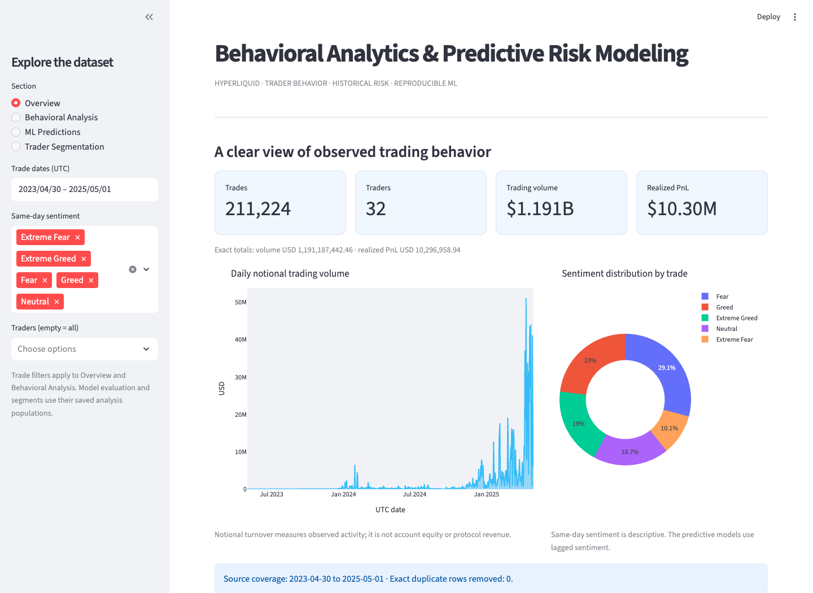
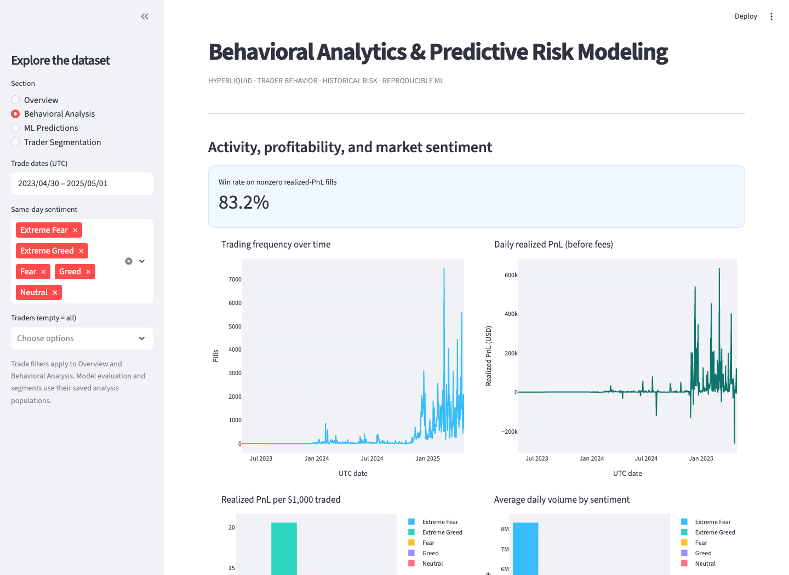
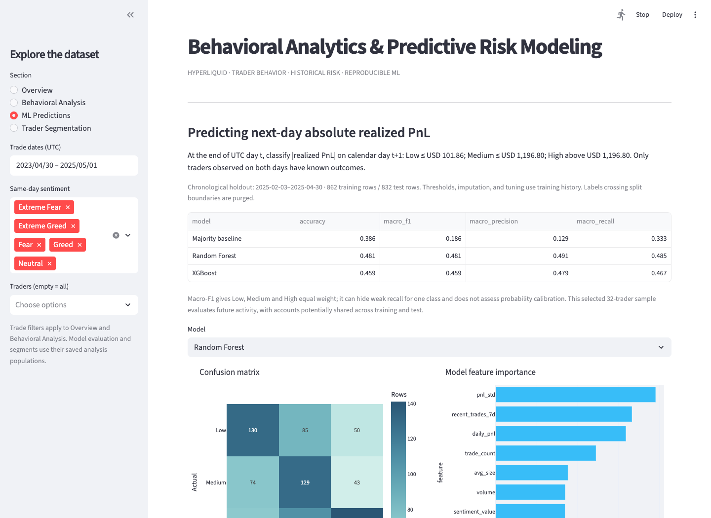
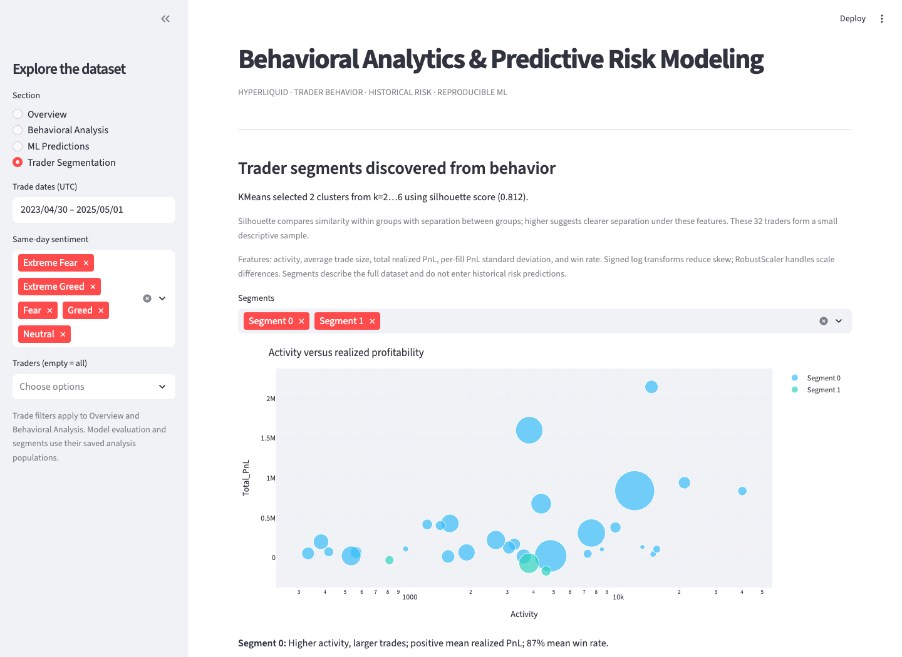
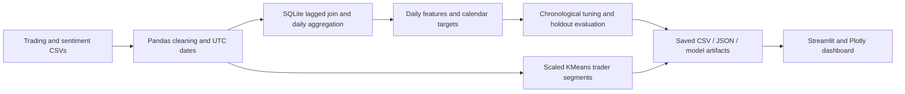

# Behavioral Analytics & Predictive Risk Modeling

Explore **211,224 Hyperliquid trades from 32 traders**, connect behavior with market sentiment, and compare Random Forest with XGBoost on a chronological prediction task. A Streamlit dashboard brings together observed trading patterns, saved model evaluation, and descriptive trader segments.

**Python · Pandas · SQLite · scikit-learn · XGBoost · Streamlit · Plotly**

[Setup & run](#setup--run) · [Model results](#evaluation-results) · [Dashboard](#dashboard) · [Technical report](docs/model_report.md) · [Verification](docs/final_verification.md)

| Trading records | Random Forest | XGBoost | Trader segmentation |
| :--- | :--- | :--- | :--- |
| **211,224** · 32 traders | **48.08%** accuracy · **0.481** macro-F1 | **45.91%** accuracy | **2 segments** · **0.812** silhouette |



*Actual source data and saved artifacts. Supervised results use 832 chronological holdout examples; segmentation describes the full 32-trader sample.*

## Problem statement

Can recent trading behavior help distinguish the magnitude of a trader's next-day realized PnL? Which observed patterns distinguish traders in this sample?

The prediction target is **next-calendar-day absolute realized PnL**, using information available **after UTC day t closes**. It measures the size of a realized outcome, including large profits. The project demonstrates data preparation, SQL, temporal feature engineering, model comparison, and clear communication of uncertainty.

## Dataset

| Source file | Coverage | Description |
| :--- | :--- | :--- |
| [historical_data.csv](data/historical_data.csv) | 211,224 fills · 32 accounts · 2023-04-30 to 2025-05-01 UTC | Hyperliquid trading export supplied with the original PrimeTrade assignment. |
| [fear_greed_index.csv](data/fear_greed_index.csv) | 2,644 daily observations · 2018-02-01 to 2025-05-02 | Broad Bitcoin sentiment proxy, described by [Alternative.me](https://alternative.me/crypto/fear-and-greed-index/). |

The original download URLs and trading-data collection methodology are not recorded in the repository. This is a selected sample, not the full exchange; sentiment is not specific to every traded asset. Both source CSVs are included. Source fingerprints and runtime versions are recorded in [results.json](outputs/portfolio/results.json). No synthetic data is used in reported results or screenshots.

## Data pipeline

1. **Clean and normalize:** remove exact duplicates and invalid required values; parse explicit IST timestamps and convert them to UTC.
2. **Join and aggregate in SQLite:** combine trader-day activity with previous-calendar-day sentiment, preserving unmatched rows.
3. **Build temporal features and labels:** calculate observed behavior and exact next-calendar-day outcomes.
4. **Evaluate chronologically:** tune on earlier history, purge labels crossing split boundaries, and evaluate saved predictions on a later holdout.
5. **Explore saved results:** load CSV, JSON and Parquet artifacts in Streamlit without retraining on refresh.

<details>
<summary>Cleaning rules and timestamp decisions</summary>

- Parse `Timestamp IST` with an explicit day-month-year format, localize to Asia/Kolkata and convert to UTC. Ignore rounded numeric epoch timestamps and IDs for time alignment and deduplication.
- Remove exact duplicate rows; discard missing accounts, invalid dates, missing/nonfinite volume or PnL, and negative volume. Keep zero PnL. The supplied CSV has **no exact duplicates or invalid required rows**; fixture tests exercise these paths.
- SQLite performs a left join to **previous-calendar-day sentiment**, groups by trader and UTC date, and persists clean trade facts and daily aggregates. Predictive sentiment is lagged because exact publication availability is unverified. Missing sentiment remains unknown; no future fill or backfill is used. Same-day sentiment appears only in descriptive charts.
- Features: daily fill count (frequency), total volume, mean size, realized PnL, win rate on nonzero-PnL fills, per-fill PnL population standard deviation, long/short direction count ratio, trailing seven-calendar-day fill count including the current day, and lagged numeric sentiment. Keep the sentiment category for exploration; the models use its numeric value.
- `long_short_ratio = long-related fills / (short-related fills + 1)`, based on the Direction field; reversals and spot Buy/Sell rows are excluded. It counts directions, not outstanding exposure or BUY/SELL orders. No realized fills means unknown win rate, imputed from training only.
- Build targets with an exact next-date self-join, never a next-observed-row shift. Account identifiers and future outcomes are excluded from model features. All nine features are available at day t close.

</details>

## Feature engineering

| Behavioral signal | Features | Interpretation |
| :--- | :--- | :--- |
| Activity | `trade_count`, `recent_trades_7d` | Today's fill count and trailing seven-calendar-day count, including today. |
| Trading size | `volume`, `avg_size` | Total daily notional volume and mean fill size in USD. |
| Realized outcomes | `daily_pnl`, `pnl_std`, `win_rate` | Daily realized PnL, per-fill PnL population standard deviation, and win rate among nonzero-PnL fills. |
| Direction | `long_short_ratio` | Long-related fill count divided by short-related fill count + 1; excludes reversals and spot Buy/Sell rows. |
| Market context | `sentiment_value` | Previous-calendar-day numeric sentiment. The category is retained for descriptive analysis. |

All nine features are available at UTC day-end. Account identifiers, future outcomes and full-history clusters are excluded from supervised inputs. Missing win rates or sentiment are imputed using training data only. Zero-PnL fills remain in activity calculations but are excluded from win-rate denominators.

## ML models

| Model | Purpose | Main choices |
| :--- | :--- | :--- |
| Majority baseline | Establish a simple reference | Always predict the most frequent training class. |
| Random Forest | Classify next-day absolute realized PnL | 120 trees, balanced class weights, three validation configurations. |
| XGBoost | Compare boosted trees with Random Forest | 120 CPU histogram trees, three validation configurations. |
| KMeans | Describe similar trader profiles | Signed-log features, RobustScaler, silhouette selection over k=2…6. |

The supervised classes use training-derived tertiles: **Low ≤ USD 101.86**, **Medium ≤ USD 1,196.80**, and **High above USD 1,196.80**. An inactive next day remains unknown rather than being labeled zero.

## Evaluation results

**Holdout feature dates: 2025-02-03 to 2025-04-30 · 832 examples · seed 42**

| Model | Accuracy | Macro-F1 | Macro precision | Macro recall |
| --- | --- | --- | --- | --- |
| Majority baseline | 38.58% | 0.186 | 0.129 | 0.333 |
| Random Forest | 48.08% | 0.481 | 0.491 | 0.485 |
| XGBoost | 45.91% | 0.459 | 0.479 | 0.467 |

**Random Forest leads this holdout**, exceeding the majority baseline by **9.50 percentage points** in accuracy. The comparison does not establish that it will outperform XGBoost across other samples or market periods.

Macro-F1 is the average of the Low, Medium and High class F1 scores, giving each class equal weight. It summarizes precision/recall balance, but can hide weak recall for an individual class and does not measure probability calibration. Per-class scores and confusion matrices are in the [model report](docs/model_report.md); raw scores are in [model_comparison.csv](outputs/portfolio/model_comparison.csv).

<details>
<summary>Chronological splits, bounded tuning and selected parameters</summary>

Predictions are made after UTC day t closes. The target is the absolute sum of realized PnL on **calendar day t+1**, conditional on that trader having recorded fills on both days. Inactive next days remain unknown, not zero. The final day's outcome is unknown.

Training tertiles define Low ≤ **$101.86**, Medium ≤ **$1,196.80**, and High above that. These are absolute monetary exposure buckets, not return volatility or downside-only risk.

Split on the first 80% of unique eligible feature dates, reserving the remaining dates for the test set. Unequal daily activity means this is not an 80/20 row split. Training: **2023-12-13–2025-02-01 (862 rows)**. Holdout feature dates: **2025-02-03–2025-04-30 (832 rows)**. Require every training outcome date to precede the next partition's first feature date. 10 boundary rows are purged.

Within training, another chronological date split starts validation on **2024-11-25** (398 inner-training / 462 validation rows). Fit inner thresholds and median imputation on inner training only. Compare three configurations per model using validation macro-F1. Refit the chosen configuration on all outer training data, relearning thresholds and imputation there. Evaluate the reserved holdout once. Both models use 120 trees, seed 42 and at most two threads. Random Forest uses balanced class weights; XGBoost uses its default unweighted multiclass objective. This compares practical configurations, not a controlled algorithm benchmark.

Selected parameters: `{"Random Forest": {"max_depth": 5, "min_samples_leaf": 3}, "XGBoost": {"learning_rate": 0.05, "max_depth": 2}}`. A `DummyClassifier(strategy="most_frequent")` supplies the majority-class baseline. Macro metrics weight all three classes equally; per-class precision and recall and confusion matrices are saved in `results.json`.

</details>

### Trader segments

KMeans selected **2 clusters** with silhouette **0.812**. Silhouette compares within-cluster closeness with separation from other clusters; higher is better separated under the chosen features and distance measure. It does not prove that the groups are useful or stable across new samples.

The profiles use activity, mean trade size, total PnL, per-fill PnL standard deviation and win rate. The groups contain **29, 3 accounts**; measured PnL and win-rate summaries appear in the profiles below. Segment numbers are arbitrary, and all clusters describe full history rather than entering historical predictions. The [bounded verification](docs/final_verification.md) found identical assignments across three fixed seeds; resampling stability remains untested.

<details>
<summary>Measured cluster profiles and segment descriptions</summary>

| Cluster | Activity | Avg_Size | Total_PnL | PnL_Volatility | Win_Rate | Traders |
| --- | --- | --- | --- | --- | --- | --- |
| 0 | 6965.4828 | 6187.1073 | 364352.4089 | 849.8294 | 0.8650 | 29 |
| 1 | 3075.0000 | 4275.8758 | -89753.6387 | 916.2468 | 0.7062 | 3 |

- **Segment 0:** Higher activity, larger trades; positive mean realized PnL; 87% mean win rate.
- **Segment 1:** Lower activity, larger trades; non-positive mean realized PnL; 71% mean win rate.

Descriptions compare cluster means with full-sample medians. They do not establish trader profession, skill or institutional status.

</details>

## Dashboard

| Section | What it shows |
| :--- | :--- |
| **Overview** | Trade count, traders, volume, realized PnL and sentiment distribution. |
| **Behavioral Analysis** | Activity, profitability, win rate and descriptive sentiment associations. |
| **ML Predictions** | Baseline, Random Forest and XGBoost evaluation, saved holdout predictions, confusion matrices and feature importance. |
| **Trader Segmentation** | Interactive trader map, measured profiles and silhouette-based cluster selection. |

Date, sentiment and trader filters apply to descriptive trades. ML evaluation and clusters use their saved analysis populations. The dashboard reads saved outputs and handles empty trade filters.

<details>
<summary>View the other three dashboard sections</summary>

### Behavioral Analysis



### ML Predictions



### Trader Segmentation



</details>

Screenshots are actual dashboard viewport captures; scroll within the application for content below the visible area.

The original README also linked a [historical Streamlit dashboard](https://primetradeanalysis.streamlit.app/). That deployment has not been verified against this completed version; use the local setup below for the maintained implementation.


## Architecture



<details>
<summary>Repository structure</summary>

```text
app.py                         # Streamlit and Plotly dashboard
src/preprocessing.py           # Cleaning, SQLite joins/aggregations, daily features
src/modeling.py                # Temporal tuning, baseline, RF/XGBoost and KMeans
src/reporting.py               # README and technical report from saved results
notebooks/main_analysis.ipynb  # Preserved historical exploration, marked as legacy
outputs/portfolio/             # Maintained artifacts, predictions and metrics
outputs/tables/                # Original notebook exports, preserved for provenance
docs/                          # Screenshots, technical report and verification
scripts/capture_dashboard.py   # Actual dashboard screenshot capture
tests/test_pipeline.py         # Focused pipeline and dashboard checks
```

</details>

## Setup & run

For a fresh checkout:

```bash
git clone https://github.com/codeit-ronit/Behavioral-Intelligence-Predictive-Risk-Modeling.git
cd Behavioral-Intelligence-Predictive-Risk-Modeling
```

From the repository root, use **Python 3.13**:

```bash
python3.13 -m venv venv
source venv/bin/activate
python -m pip install -r requirements.txt
python -m src.modeling
python -m streamlit run app.py
```

On Windows PowerShell, use `venv\Scripts\Activate.ps1` instead of `source venv/bin/activate`.

Open **http://localhost:8501**. Training is a separate one-time step; refreshing the dashboard does not train models. If the existing workspace already contains generated artifacts, activate its `venv` and run only the final command.

<details>
<summary>Interpreter setup and macOS troubleshooting</summary>

If `python3.13` is not on PATH, use the executable path of your installed Python 3.13 interpreter for the first command. For an existing working environment, find that path with:

```bash
venv/bin/python -c "import sys; print(sys._base_executable)"
```

Use the printed executable with `-m venv venv`, then continue with activation and installation. This avoids assuming a particular Homebrew or Conda installation directory. On macOS, if XGBoost reports a missing `libomp.dylib`, run `brew install libomp` and retry.

</details>

Training uses at most two threads and requires no GPU. Six bounded tuning fits and three final supervised fits are used. Large generated datasets, the SQLite database and fitted models are ignored by Git; regenerate them after cloning. Small CSV/JSON results and screenshots are retained for review. Only load locally generated Joblib files.

The pipeline writes maintained outputs to `outputs/portfolio/` and regenerates the result-dependent README and technical report. Change the README layout in `src/reporting.py` so later runs retain it. Preserved notebook exports are separate from the maintained artifacts.

<details>
<summary>Optional preprocessing, checks and screenshot reproduction</summary>

```bash
# Rebuild data only; rerun modeling afterwards if source data changes
python -c "from src.preprocessing import preprocess; preprocess()"

# Focused existing checks; no model retraining
python -m unittest discover -s tests -v

# Screenshots: requires Google Chrome and the dashboard running on port 8501
python -m pip install -r requirements-dev.txt
python scripts/capture_dashboard.py
```

Runtime dependencies: Pandas, NumPy, SQLite (standard library), scikit-learn, XGBoost, Streamlit, Plotly, PyArrow and Joblib. Jupyter, Matplotlib and Seaborn support the preserved notebook. No cloud services or model-tracking infrastructure are required.

</details>

## Key findings

- Observed notional turnover totals **$1,191,187,442.46** across **211,224 fills** and **32 traders**. Realized PnL totals **$10,296,958.94**, before fees.
- **Extreme Fear** has the largest average daily volume among observed sentiment groups (**$8,316,170**). This is an association in this sample, not evidence of causality.
- The fill-weighted win rate among nonzero realized-PnL fills is **83.2%**. Zero-PnL fills are excluded; this is not a position-level success rate.
- Random Forest exceeds the majority baseline by **9.50 percentage points** in holdout accuracy. Its three largest impurity-based feature importances are **pnl_std, recent_trades_7d, daily_pnl**.
- KMeans selects **2 segments** with silhouette **0.812**. Segment sizes are **29, 3**; the smaller group limits interpretation.

## Verification

The [final bounded verification](docs/final_verification.md) records leakage checks, saved prediction/metric replay, three-seed clustering agreement, a clean-environment dependency installation, browser rendering of all four sections, and support for all four resume bullets. The [machine-readable evidence](docs/final_verification_evidence.json) records those results. These checks were completed without repeating supervised training.

The original [implementation verification log](docs/verification.md) is retained as historical evidence. Existing tests cover cleaning, missing values, UTC rollover, SQL totals, exact calendar targets, past-feature invariance, purged splits, training-only thresholds, saved predictions, cluster selection and empty dashboard filters.

## Limitations

- Only 32 selected traders: results may not generalize to the wider platform, new accounts, or future market regimes. The same accounts may occur in training and test; this evaluates future behavior, not unseen-trader generalization.
- Realized PnL depends on trade size, inventory closure and execution behavior. Large profits also count as High; there are no equity, leverage, complete position histories, verified fraud labels, or reliable mark-to-market returns. This is not fraud detection.
- Conditioning on observed activity tomorrow excludes inactive days and can introduce selection bias. Class boundaries are sample-dependent. High-class recall is modest; predictions are exploratory and probabilities are uncalibrated.
- The export rounds epoch timestamps and trade IDs. Explicit IST timestamps are used instead; only exact row duplicates are removed. Minute-level timing and an unverified export history limit precision.
- Realized PnL is before fees. Win rate is based on nonzero-PnL fills, not completed positions. Sentiment is a broad Bitcoin proxy and may not represent every asset. One daily row lacks lagged sentiment and is imputed only from training data.
- Clustering uses the full dataset for descriptive exploration, including total PnL. Signed-log scaling separates positive and negative monetary outcomes strongly; high silhouette alone does not establish stable behavioral types. There are only three accounts in the smaller cluster.
- The original notebook and its historical exports remain for provenance. Its old random-split scores, assumed archetype names, and untested strategy recommendations are not validated claims of this version.

Future improvements: gather a broader trader sample and account equity, evaluate rolling temporal holdouts and unseen accounts, test cluster stability under resampling, and calibrate probabilities using training history. These are not implemented.
